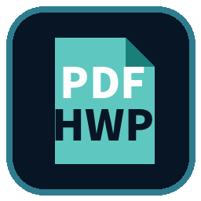
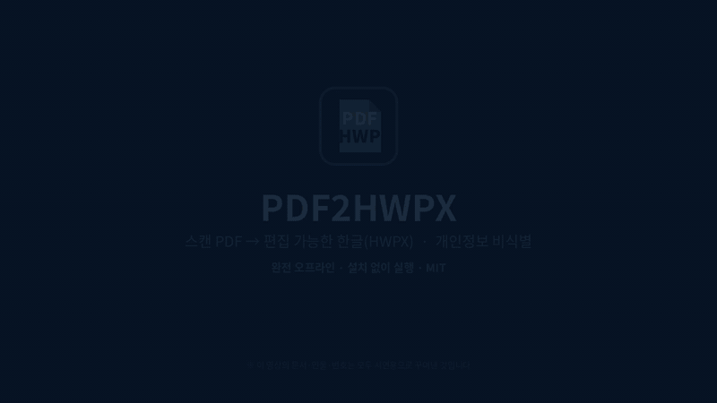
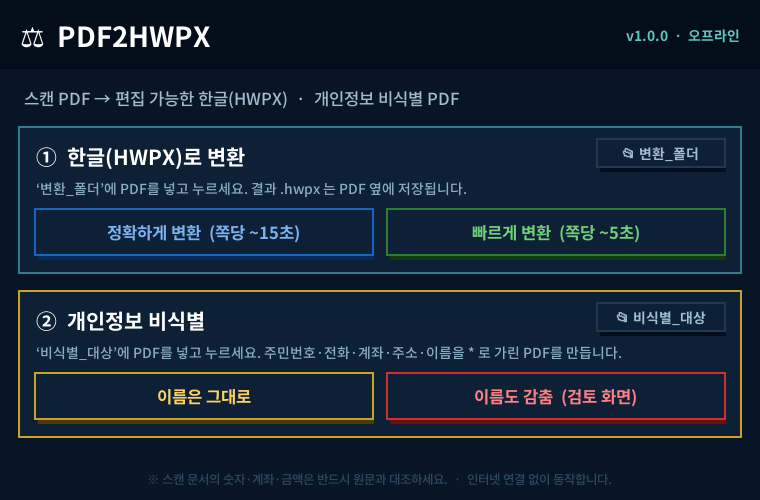
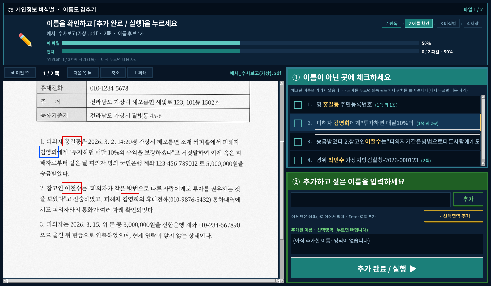
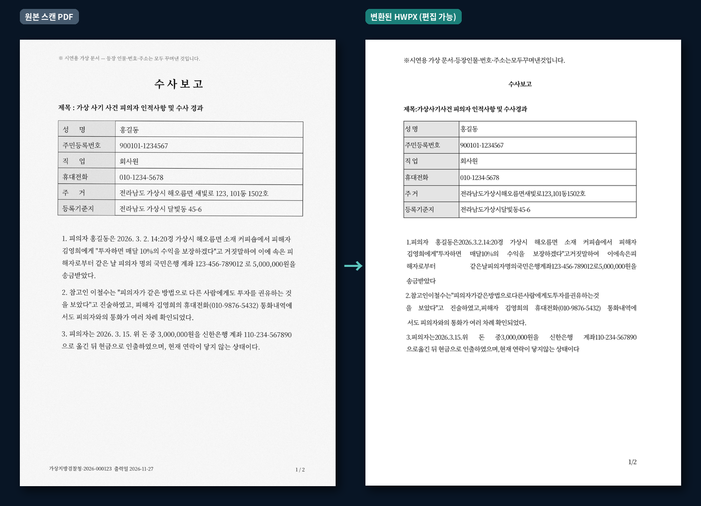
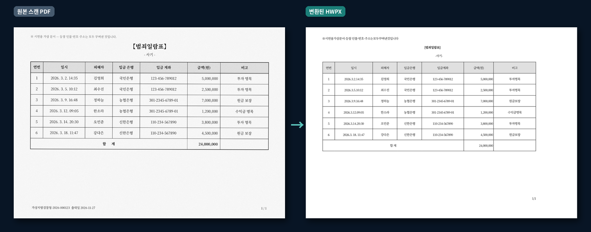
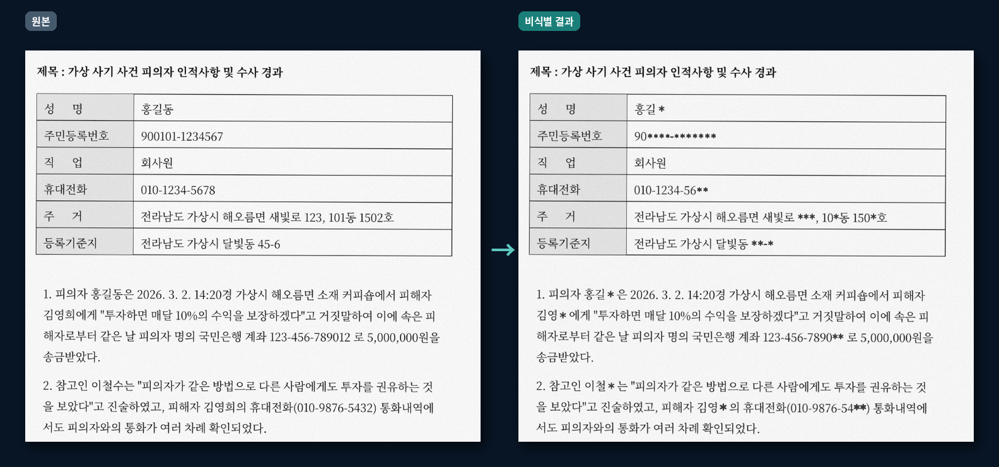
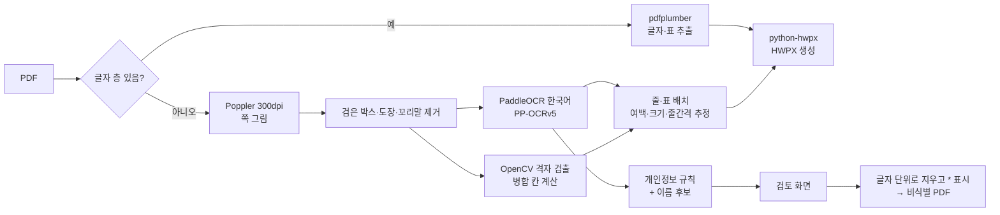

<div align="center">



# PDF2HWPX

**스캔 PDF를 편집 가능한 한글(HWPX) 문서로 바꾸고, 개인정보를 자동으로 가려 주는 오프라인 도구**

[](https://github.com/jangmyeon061-boop/pdf2hwpx/releases/latest)
[](LICENSE)


[](https://github.com/jangmyeon061-boop/pdf2hwpx/actions/workflows/demo.yml)



<sub>▲ 시연 영상(고화질 MP4: <a href="docs/demo.mp4">docs/demo.mp4</a>) — 화면의 문서는 모두 <b>시연용으로 꾸며낸 가상 문서</b>입니다.</sub>

</div>

---

## ✨ 무엇을 하나요?

| | 기능 | 설명 |
|:-:|---|---|
| 📄 | **한글(HWPX) 변환** | 스캔 이미지 PDF를 글자·표가 살아 있는 `.hwpx` 로 바꿉니다. 원본의 **여백·글자 크기·줄 간격·표 구조(병합 칸 포함)** 를 최대한 그대로 재현합니다. |
| ⚡ | **두 가지 속도** | `정확하게 변환`(쪽당 약 15초, 기본) / `빠르게 변환`(쪽당 약 5초, 경량 모델) |
| 🕶️ | **개인정보 비식별** | 주민번호·전화·계좌·카드·차량·이메일·주소·이름을 찾아 **그 글자만** `*` 로 가린 PDF를 만듭니다. 자간·줄간격은 건드리지 않습니다. |
| ✅ | **검토 화면** | 자동으로 찾은 이름 후보를 원문과 나란히 보며 “이름 아님”을 체크하고, 빠진 이름을 추가하고, 마우스로 영역을 그려 검정 블록으로 가릴 수 있습니다. |
| 🔒 | **완전 오프라인** | 모델·실행환경이 모두 들어 있어 **인터넷이 없는 PC에서도** 동작합니다. 문서가 외부로 나가지 않습니다. |

## 🖼️ 화면

<table>
<tr>
<td width="50%"><br><sub><b>실행 화면</b> — 폴더에 PDF를 넣고 버튼 하나</sub></td>
<td width="50%"><br><sub><b>비식별 검토 화면</b> — 이름 후보 확인·추가, 영역 지정</sub></td>
</tr>
</table>

### 스캔 PDF → 한글(HWPX)



<sub>왼쪽: 원본 스캔 PDF · 오른쪽: 변환된 HWPX(글자를 고칠 수 있는 문서). 표의 칸 병합·음영·정렬, 제목 크기, 들여쓰기까지 옮깁니다.</sub>



<sub>범죄일람표 같은 큰 표도 칸 구분·합계행 병합을 살려 옮깁니다. (오른쪽 그림은 <code>scripts/hwpx_preview.py</code> 로 그린 HWPX 미리보기)</sub>

### 개인정보 비식별



<sub>이름은 한 글자, 주민번호는 출생연도 2자리만 남기고, 전화·계좌는 끝 2자리, 주소는 상세 번지만 가립니다.</sub>

## 🚀 바로 쓰기 (Windows)

1. **[Releases](https://github.com/jangmyeon061-boop/pdf2hwpx/releases/latest)** 에서 `PDF2HWPX-x.y.z-win64.zip` 을 받아 원하는 곳(예: `C:\PDF2HWPX`)에 압축을 풉니다.  
   파이썬·OCR 모델·Poppler가 모두 들어 있어 **따로 설치할 것이 없습니다.**
2. `PDF2HWPX.exe` 를 실행합니다.
3. 한글 변환은 `변환_폴더`, 비식별은 `비식별_대상` 폴더에 PDF를 넣고 버튼을 누릅니다.  
   결과는 원본 PDF 옆에 `.hwpx` / `_비식별.pdf` 로 저장됩니다.

> [!TIP]
> 인터넷이 막힌 PC로 옮길 때는 압축을 푼 **폴더째** 복사하면 됩니다. 처음 실행할 때 모델을 내려받지 않습니다.

> [!IMPORTANT]
> OCR은 100% 정확하지 않습니다. **숫자·계좌·금액·날짜는 반드시 원문과 대조**하세요. 비식별 결과도 배포 전 눈으로 확인하세요.

<details>
<summary><b>명령줄로 쓰기</b></summary>

```bat
PDF2HWPX.exe convert            :: 변환_폴더 안 PDF 전부(정확)
PDF2HWPX.exe convert --fast D:\문서\사건.pdf
PDF2HWPX.exe redact --keep-names D:\문서      :: 이름은 그대로, 나머지만
PDF2HWPX.exe redact --auto D:\문서            :: 검토 없이 이름까지 자동
```
</details>

## 🛠️ 소스에서 실행

```bash
git clone https://github.com/jangmyeon061-boop/pdf2hwpx
cd pdf2hwpx
pip install -r requirements.txt          # Python 3.10 ~ 3.12
python scripts/fetch_models.py           # 모델을 app/paddlex_home 에 받아 둠(한 번)

python app/pdf2hwpx.py samples/          # 예시 PDF → .hwpx
python app/pii_redact.py samples/ --auto # 예시 PDF → _비식별.pdf
python app/launcher.py                   # 실행 화면
```

Poppler(`pdftoppm`)가 필요합니다 — Windows는 `app/vendor/poppler` 에 두거나 `POPPLER_PATH` 지정, Linux는 `apt install poppler-utils`.

| 환경변수 | 기본값 | 설명 |
|---|---|---|
| `PDF2HWPX_DET_MODEL` | `PP-OCRv5_server_det` | `PP-OCRv5_mobile_det` 로 주면 빠른 모드 (`--fast` 와 같음) |
| `PDF2HWPX_REC_ONEDNN` | `1` | 글자 판독 단계 CPU 가속(oneDNN). 문제 시 `0` |
| `PDF2HWPX_RASTER_CHUNK` | `4` | 몇 쪽씩 묶어 그림으로 바꿀지 |
| `PDF2HWPX_WORKDIR` | 프로그램 폴더 | `변환_폴더`·`비식별_대상`·로그 위치 |

## 🕶️ 비식별 규칙

| 대상 | 예 (가상) | 결과 |
|---|---|---|
| 주민등록번호 | `900101-1234567` | `90****-*******` (출생연도 2자리만) |
| 휴대전화·전화 | `010-1234-5678` | `010-1234-56**` |
| 계좌·카드·사업자·차량번호 | `123-456-789012` | `123-456-7890**` |
| 이메일 | `gildong@example.com` | `gildo**@example.com` |
| 주소 | `가상시 해오름면 새빛로 123, 101동 1502호` | `… 새빛로 ***, 10*동 150*호` (읍·면·동·도로명은 유지) |
| 사람 이름 | `홍길동` | `홍길*` (여러 이름이 겹치지 않게 가릴 글자를 고름) |

## ⚙️ 동작 방식



## 📁 구성

```
app/
  pdf2hwpx.py     PDF → HWPX 변환기(OCR 엔진·표 인식·외형 재현)
  pii_redact.py   비식별 규칙·글자 단위 마스킹
  pii_gui.py      비식별 검토 화면 · 진행 안내판
  launcher.py     실행 화면(배포판의 PDF2HWPX.exe)
  ui_theme.py     화면 공통 색·버튼
scripts/
  fetch_models.py 오프라인용 모델 받기
  demo_run.py     예시 문서로 전체 과정 실행(시연 재료)
  hwpx_preview.py HWPX → HTML 간이 미리보기(한글 프로그램 없이 확인)
samples/          시연용 가상 문서(make_samples.py 로 다시 만들 수 있음)
.github/workflows/
  release.yml     Windows 실행판 빌드 → 릴리즈 첨부
  demo.yml        예시 문서로 동작 시험
```

## 📏 속도 (참고)

Intel i5-12400(6코어), 스캔 21쪽 문서 기준

| 모드 | 쪽당 | 비고 |
|---|---:|---|
| 정확하게 변환 | 약 15초 | 서버 탐지모델 + 판독 가속 |
| 빠르게 변환 | 약 5초 | 경량 탐지모델 — 줄·표 배치가 조금 거칠어질 수 있음 |

## 🙏 사용한 오픈소스

- [PaddleOCR](https://github.com/PaddlePaddle/PaddleOCR) · [PaddlePaddle](https://github.com/PaddlePaddle/Paddle) — Apache-2.0
- [python-hwpx](https://github.com/airmang/python-hwpx) — Apache-2.0
- [pdfplumber](https://github.com/jsvine/pdfplumber) — MIT · [pdf2image](https://github.com/Belval/pdf2image) — MIT · [OpenCV](https://opencv.org/) — Apache-2.0
- [Poppler](https://poppler.freedesktop.org/) — GPL (배포판에 수정 없이 포함, Windows 빌드: [poppler-windows](https://github.com/oschwartz10612/poppler-windows))

“한글”, “HWP/HWPX”는 ㈜한글과컴퓨터의 상표입니다. 이 프로젝트는 한글과컴퓨터와 관련이 없습니다.

## 📜 라이선스

[MIT](LICENSE) © 2026 jangmyeon061-boop

`samples/` 의 문서와 시연 화면에 나오는 인물·주민번호·전화·계좌·주소는 **모두 꾸며낸 것**이며 실제 사건·인물과 무관합니다.
